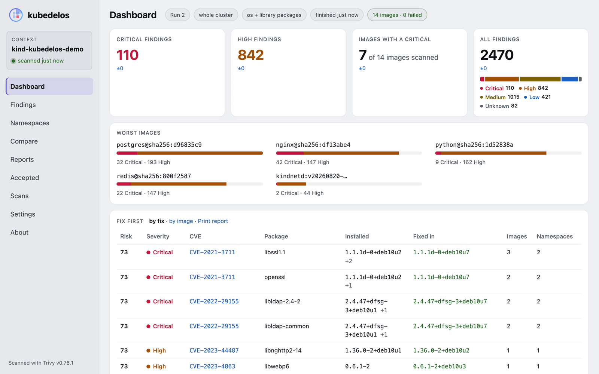
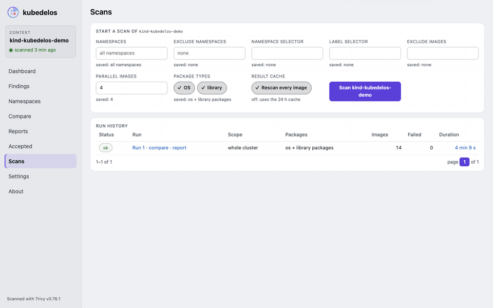
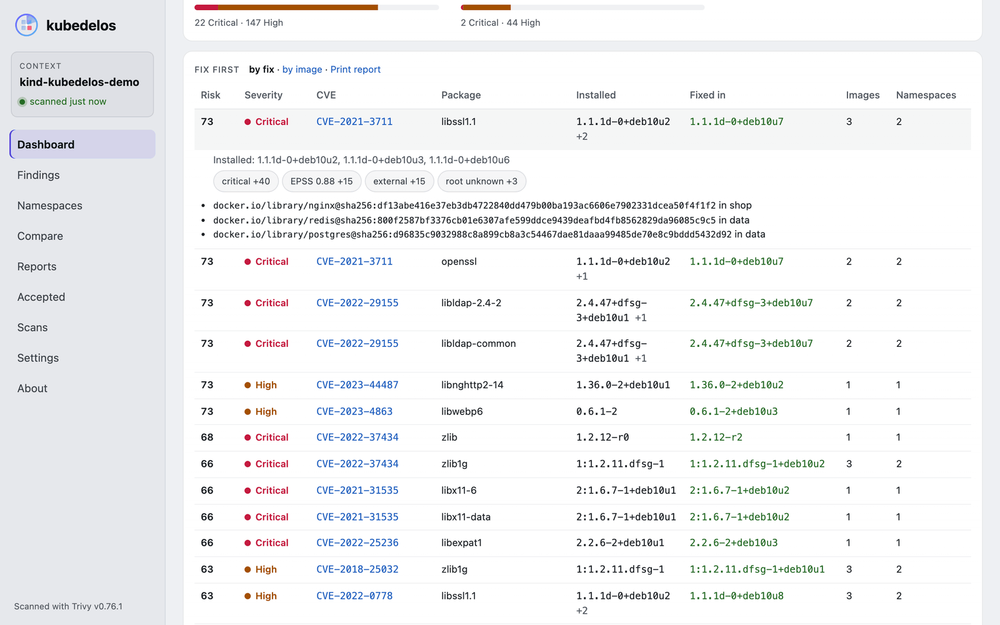

# kubedelos

[](https://github.com/k8s-servant/kubedelos/actions/workflows/ci.yml)
[](https://scorecard.dev/viewer/?uri=github.com/k8s-servant/kubedelos)
[](LICENSE)

Scan the container images running in a Kubernetes cluster with Trivy.

Status: pre-alpha. Interfaces and output may change.

<picture>
  <source media="(prefers-color-scheme: dark)" srcset="docs/images/dashboard-dark.png">
  
</picture>

## Why kubedelos

[Trivy](https://github.com/aquasecurity/trivy) does the scanning, and kubedelos doesn't replace it: `trivy image` and
`trivy k8s` tell you what is vulnerable right now. kubedelos is for what comes after that report, across a whole cluster
and over time:

- **What actually runs.** It lists the images running in the cluster, including init and ephemeral containers, CronJobs
  and workloads scaled to zero. Access is read-only and Secrets are not read (in `serve`, except opt-in pod pull
  secrets, see below). Each unique image is scanned once per platform.
- **What to fix first.** The dashboard puts the Critical and High findings that have a fix on top, grouped by fix or by
  image and ordered by a risk score that weighs exposure and known exploitation, with the images worst hit and the
  images that failed to scan, plus a hint on which registry to log in to.
- **What changed.** Every run is kept in a local SQLite database, so the dashboard shows the change since the last
  comparable run, and the findings of any earlier run can be opened again.
- **One command, nothing to install in the cluster.** `kubedelos ui` opens a local web UI against your current
  kube-context. There is no operator, CRD or host app such as Lens or Headlamp to set up first.
- **Cheap repeat scans.** Results are cached by image, so a rescan only scans what changed.
- **Careful by default.** Trivy is pinned and checksum-verified, never "latest", and registry tokens are never written
  to disk or logs.

kubedelos doesn't gate CI pipelines: Trivy already does that well. The in-cluster mode is installed with Helm and
has scheduled scans and the same UI for each cluster; reports sent to each namespace's owners by email, Slack or Teams
are next on the roadmap.

## Quickstart

```bash
pipx install kubedelos        # or: uv tool install kubedelos
kubedelos ui
```

`kubedelos ui` opens a local web UI against your current kube-context. Start a scan on the Scans page: kubedelos lists
the workloads in the cluster, scans each unique image once with Trivy, and shows the results on the dashboard. Owners
are read from the `kubedelos.io/owner-email` namespace annotation. [Install](docs/install.md) has the requirements, the
cluster permissions, uv and the Helm chart.



## Contents

- [Documentation](#documentation)
- [Local web UI](#local-web-ui)
- [In a cluster](#in-a-cluster)
- [What gets scanned](#what-gets-scanned)
- [What to fix first](#what-to-fix-first)
- [Ask your agent](#ask-your-agent)
- [Configuration](#configuration)
- [Compatibility](#compatibility)
- [Trivy](#trivy)
- [Private registries](#private-registries)
- [Contributing and security](#contributing-and-security)
- [License](#license)

## Documentation

The [documentation index](docs/README.md) lists every guide. The main ones:

| Guide | For |
|---|---|
| [Install](docs/install.md) | Installing on your machine or in a cluster, permissions, upgrading and uninstalling |
| [The local web UI](docs/ui.md) | What each page shows |
| [Configuration](docs/configuration.md) | Every `KUBEDELOS_*` setting |
| [Running kubedelos in a cluster](docs/in-cluster.md) | The Helm chart, exposing the UI and the security model |
| [How a scan works](docs/how-scans-work.md) | What a scan reads, downloads and keeps, and tuning a slow scan |
| [Risk score](docs/risk-score.md) and [attack-surface facts](docs/attack-surface.md) | Why the fix-first list is in that order |
| [Ask your agent](docs/mcp.md) | `kubedelos mcp` for Claude Code, VS Code Copilot and others |

## Local web UI

`kubedelos ui` serves a web UI over the scan data in your local SQLite database, and starts scans of any context in
your kubeconfig. It listens on loopback only and prints a URL with a token:

```bash
kubedelos ui                          # http://127.0.0.1:9370/?token=...
kubedelos ui --port 9400 --no-browser
```

The dashboard shows the latest run with the change since the previous comparable one, the fix-first list, the worst
images and the images that failed to scan. Other pages list and filter the findings (with a CSV download), rank
namespaces, compare two runs, print a report, keep an accepted risk register, start and follow scans, and show where a
scan's time went. Add `?run_id=N` to pin a page to one run. [The local web UI](docs/ui.md) describes every page and how
to use it on a remote machine over SSH.

## In a cluster

`kubedelos serve`, installed with the Helm chart, serves the UI of one cluster, sweeps it on a cron schedule and keeps
the results:

```bash
helm install kubedelos oci://ghcr.io/k8s-servant/charts/kubedelos --set clusterName=my-cluster
```

The chart runs one hardened replica with a volume for the data, a read-only ClusterRole and a NetworkPolicy, and the
image bundles the pinned Trivy. [Install](docs/install.md#in-a-cluster) also shows how to install it from a clone.

**Anyone who can reach `serve` can read the whole vulnerability inventory, and by default can also write**: start
scans within the configured scope, retry or cancel them, and accept or revoke risks. Set `readOnly: true`, put it
behind an authenticating proxy, or keep it cluster-internal. [Running kubedelos in a cluster](docs/in-cluster.md) has
every value, the security model, how to expose the UI and how to verify the signed image and chart with cosign; [an
example](docs/exposure-oauth2-proxy-envoy-gateway.md) puts it behind oauth2-proxy and Envoy Gateway.

## What gets scanned

A scan covers the images of running pods, including init and ephemeral containers, plus the pod templates of CronJobs
and of Deployments and StatefulSets scaled to zero. Namespaces, namespace and pod label selectors and image exclusions
narrow it, and OS packages, application libraries or both can be scanned. Results are cached for 24 hours by image
digest, so a repeat scan only scans what changed. A namespace or resource kubedelos may not list is skipped with a
warning and the run is marked incomplete, never clean. [How a scan works](docs/how-scans-work.md) explains each step,
the caches and DBs, parallelism, time limits and how to speed up a slow scan.

## What to fix first

Severity alone ranks a Critical CVE in a pod nothing can reach above a High one that attackers already exploit, in a pod
on the internet with a cluster-admin token. So kubedelos gives each finding a risk score from 0 to 100: severity, plus
points for known exploitation (CISA KEV and EPSS), how far the workload is exposed, whether it can reach the node and
what its ServiceAccount may do. The fix-first lists are ordered by it, the findings page sorts by it (`sort=risk`), and
each score comes with the factors behind it. Missing facts count as unknown, never as safe. See [Risk
score](docs/risk-score.md).

The exposure, host access and rights come from the [attack-surface facts](docs/attack-surface.md) each scan records per
workload container, from list calls only and without reading a Secret. The two threat feeds are downloaded at most once
a day with plain GETs that send nothing about the cluster. `KUBEDELOS_ATTACK_SURFACE=false` and
`KUBEDELOS_THREAT_FEEDS=false` turn them off.

<picture>
  <source media="(prefers-color-scheme: dark)" srcset="docs/images/fix-first-dark.png">
  
</picture>

## Ask your agent

`kubedelos mcp` is a read-only MCP server over stdio, so the agent you already use (Claude Code, VS Code Copilot) can
answer "what should I fix first in my-cluster?" from your local scan results. It never reaches the cluster, calls no
LLM and needs no API key: `claude mcp add kubedelos -- kubedelos mcp`. See [Ask your agent](docs/mcp.md).

## Configuration

Settings come from `KUBEDELOS_*` environment variables, such as `KUBEDELOS_NAMESPACES`, `KUBEDELOS_PARALLELISM` and
`KUBEDELOS_PKG_TYPES`; list variables take a JSON list:

```bash
KUBEDELOS_NAMESPACES='["team-a","team-b"]' kubedelos ui
```

[Configuration](docs/configuration.md) lists every setting with its default, and the UI's Settings page shows the ones
in use and where each value came from.

## Compatibility

| Area | Supported | Notes |
|---|---|---|
| Python | 3.12, 3.13, 3.14 | Each is tested in CI. |
| Runs on | Linux and macOS, amd64 and arm64 | Windows is not supported. |
| Trivy | v0.76.1, pinned and checksum-verified | `KUBEDELOS_TRIVY_PATH` runs your own binary; its results are not cached. |
| Kubernetes | 1.35, tested on kind | Read-only `list` calls on stable APIs only: `v1` namespaces, pods and nodes, `apps/v1` Deployments and StatefulSets, `batch/v1` CronJobs. Secrets are not read, except the opt-in pod pull secrets of `serve` (`get` on `secrets` in the namespaces you list). |
| Image platforms | Linux images | Tested on `linux/arm64` nodes. Windows nodes' images are scanned for their own platform but are untested. |
| Registries | Public registries, and private ones through your Docker credentials | Tested with Docker Hub and `registry.k8s.io`. See [Private registries](#private-registries) for ACR, Artifact Registry and ECR logins. |

Managed clusters (AKS, EKS, GKE) are not yet verified; they come with the in-cluster mode.

## Trivy

kubedelos runs a pinned Trivy release (v0.76.1) as one standalone process per image, sharing one locked DB cache. It runs on Linux and macOS (amd64 and arm64); Windows is not supported. `kubedelos trivy install` downloads it
and checks it against an embedded SHA-256. It never resolves "latest". Set `KUBEDELOS_TRIVY_PATH` to bring your own binary; it must be Trivy v0.54.0 or later, the first with
`--pkg-types`, or every image fails. Results from your own binary are not cached and the run records its Trivy version as `custom`.

kubedelos is built on [Trivy](https://github.com/aquasecurity/trivy), an open source scanner by Aqua Security,
licensed under Apache-2.0. kubedelos is an independent project, not affiliated with or endorsed by Aqua Security.

## Private registries

kubedelos uses the Docker credentials you already have (`DOCKER_CONFIG` or `~/.docker/config.json`, including
credential helpers), so log in the way you normally would, for example `docker login registry.example` or
`az acr login --name myregistry`. `kubedelos registry test registry.example/team/app:1.2.3` checks access to one image,
and when images fail registry auth in a scan, the dashboard names the registry to log in to. See
[Install](docs/install.md#private-registries).

In a cluster, `kubedelos serve` reads private registries with a cloud workload identity, mounted Docker config Secrets
and, if you opt in, the pull secrets of the pods it scans:

- [Azure Container Registry from AKS](docs/registries/acr.md)
- [Amazon ECR from EKS](docs/registries/ecr.md)
- [Google Artifact Registry from GKE](docs/registries/gar.md)
- [Pull secrets and Docker configs](docs/registries/pull-secrets.md)

## Contributing and security

See [CONTRIBUTING.md](CONTRIBUTING.md) to build and test kubedelos, and [SECURITY.md](SECURITY.md) to report a
vulnerability privately.

## License

Apache-2.0
