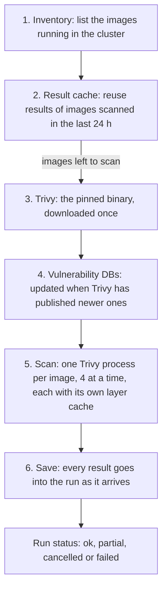

# How a scan works

This page explains what happens between pressing **Scan** and seeing findings: what kubedelos reads, what it
downloads, what it keeps on disk and why, and which knobs change how long a scan takes. The settings named here are
listed in the [README](../README.md#configuration) and, with their current values, on the UI's Settings page.

## In short

One scan runs at a time, across all clusters. The Scans page shows its progress live, and you can cancel it there.

## 1. Inventory: what is running

kubedelos asks the Kubernetes API, read-only, for the namespaces and pods in scope. It collects the images of running
pods (including init and ephemeral containers), plus the pod templates of CronJobs and of Deployments and StatefulSets
scaled to zero, so an image that runs only now and then is still scanned. It never changes the cluster and never reads
Secrets.

The same image used by many pods is scanned once. Images are grouped by digest (or by name when the node reports no
digest) and by platform: each image is scanned for the OS and architecture of the node it runs on (`linux/amd64`,
`linux/arm64` and so on).

A namespace or resource your identity may not list is skipped with a warning, and the run is marked incomplete, so a
gap never reads as "no findings". See [What gets scanned](../README.md#what-gets-scanned) for selectors and exclusions.

## 2. The result cache: skip what was just scanned

**What:** the findings of each image, stored in the kubedelos database (`kubedelos.db` in the data directory).

**Key:** the image digest, the platform, the scan level (OS packages, libraries or both) and the Trivy version. An
image the node reports without a registry digest (kind's preloaded images, for example) is keyed by its local image ID
instead, and only when Trivy scanned exactly that image.

**Lifetime:** 24 hours. A result older than that is not reused, and the image is scanned again.

**Why:** a digest names the exact image content, so scanning it twice in a day finds the same packages. On a cluster
where most images don't change between scans, a rescan only scans what changed.

**Keep in mind:**

- An image known only by its tag is **never** cached, because the tag can be pushed again with other content.
- A cached result keeps the findings from when it was scanned. If Trivy published a new vulnerability DB since, a CVE
  added in that DB shows up once the cached result is older than 24 hours and the image is scanned again.
- Results from your own Trivy binary (`KUBEDELOS_TRIVY_PATH`) are never cached.
- The Scans page counts cached images apart from scanned ones, and the scan times page lists them as cached.

## 3. Trivy: the pinned binary

kubedelos runs a pinned Trivy release (v0.76.1), never "latest". The first scan downloads it from GitHub into the cache
directory (`trivy/0.76.1/trivy`, about 160 MB unpacked) and checks it against a SHA-256 built into kubedelos. Later
scans reuse it. `kubedelos trivy install` does the same ahead of time.

## 4. The vulnerability DBs: what the findings are matched against

**What:** Trivy matches the packages it finds in an image against two databases:

| DB | Size | Needed for |
| -- | ---- | ---------- |
| Vulnerability DB (`trivy-cache/db`) | about 1.6 GB | every scan |
| Java DB (`trivy-cache/java-db`) | about 1.5 GB | scans that include libraries (Java archives) |

**When they update:** at the start of every scan, before any image is scanned. Trivy publishes a new vulnerability DB
a few times a day, and each DB says when the next one is due. Before that time the check takes a fraction of a second
and downloads nothing; after it, the scan downloads the new DB first. The first scan ever downloads both, which takes a
few minutes. An OS-packages-only scan never needs the Java DB.

**Shared and locked:** all parallel scans, and scans from several `kubedelos ui` processes, read the same DBs. A file
lock makes sure no scan replaces a DB while another scan is reading it.

**How fresh is mine?** The About page shows when the DBs in use were built and downloaded, and whether a newer one is
out.

## 5. Scanning: one Trivy per image, in parallel

Each image is scanned by its own `trivy image` process, with the vulnerability scanner only. Trivy fetches the image
**from the registry**, over the network, to the machine running kubedelos; it does not read the image from the
cluster's nodes. It uses your Docker login for private registries (see
[Private registries](../README.md#private-registries)).

### Parallelism

`KUBEDELOS_PARALLELISM` (default 4, at most 32, and changeable for one scan on the Scans page) is how many images are
scanned at once. When one finishes, the next starts.

More parallel images finish a large cluster sooner **as long as the network keeps up**. All the parallel scans share
your connection to the registries: with 4 large images downloading at once, each gets about a quarter of the bandwidth
and takes about four times as long. That is the usual reason big images run out of time.

### The time limit

`KUBEDELOS_SCAN_TIMEOUT_S` (default 600 seconds) is how long one image may take, download included. An image that
runs out of time fails with the kind `timeout` and keeps nothing: the next attempt starts from the beginning.

### One retry for network hiccups

An image that fails with a passing network error (an interrupted download, a connection reset, a registry answering
502, 503, 504 or "too many requests") is tried once more after 2 seconds. If that fails too, its error starts with
"failed twice". Timeouts, auth errors and missing images are not retried this way.

### The layer cache: skip layers already analysed

**What:** for each image layer, Trivy keeps what it found in it (the packages, not the layer itself), in
`trivy-layers/slot-N` under the cache directory.

**Why:** most images share layers. New tags of the same app share all but the top layers, and many apps share a base
image. With the layer cache, Trivy downloads and analyses only the layers it hasn't seen, so a rescan of a changed
image is much faster. On a test cluster, rescans took 1.2–1.9 s an image instead of 2.6–14 s.

**Why slots:** Trivy locks its layer cache for the whole of a scan, so two parallel scans can't share one. There are
32 slots, one for each parallel scan allowed. Each image goes to the slot its repository name points to, so the next
scan of that repository, and its new tags, find their layers there. If that slot is busy, the image takes a free one;
if none is free (another `kubedelos ui` uses them), it keeps its layer cache in memory for that scan, as kubedelos did
before the layer cache.

**Size:** about 1–4 MB an image. A slot past 128 MB is emptied before its next use, so the layer cache never grows past
4 GB. `KUBEDELOS_LAYER_CACHE=false` turns it off.

## 6. Saving and the run's status

Each result is saved as soon as it arrives, so the Scans page and the failures page show progress while the scan
runs. When the scan ends, the run gets one of these statuses:

| Status | Meaning |
| ------ | ------- |
| `ok` | every image was scanned or taken from the cache |
| `partial` | some images failed; their findings are missing, everything else is complete |
| `cancelled` | you stopped the scan; images already done are kept, none was started after the cancel |
| `failed` | the scan stopped part-way, for example because Trivy or its DB could not be downloaded |

A cluster that can't be reached stops the scan before a run is recorded; the Scans page shows the error. A scan killed
outright (a closed laptop, a crash) leaves its run marked running; when the UI starts, and before each new scan, it
closes every run no live process owns, with a note saying so.

The sidebar marks a cluster's newest scan as stale once it is more than 24 hours old.

## When images fail

The failures page of a run lists each failed image with its kind:

| Kind | Usual cause | What helps |
| ---- | ----------- | ---------- |
| `timeout` | a large image on a busy connection | retry with a longer limit and fewer parallel images |
| `auth` | the registry refused your login, or the login expired | log in again (the page shows the command), then retry |
| `not_found` | the tag is no longer in the registry | push the tag, or fix the workload; a retry fails again |
| `trivy` | Trivy could not read the image | read the error; often a retry helps |
| `unknown` | anything else | read the error |

**Retry failed images** (on the newest partial run of a cluster) scans the ticked kinds of failure again, without
reading the cluster, and puts the results into the same run. It starts with a longer time limit (three times the
setting, at most 3,600 s) and 2 parallel images, which helps large images most. Every kind but `not_found` is ticked at
first.

## Tuning a slow scan

The scan times page of a run (linked from each run's duration in the Scans history) lists the slowest images and
says how much of the time the 10 slowest took.

- **A few images take most of the time:** they are large. Raise `KUBEDELOS_SCAN_TIMEOUT_S`, or let them time out and
  retry them with a longer limit and fewer parallel images.
- **Many ordinary images are slow:** the network is the limit. Fewer parallel images may finish no later, and fail
  less; more parallel images won't help.
- **The first scan is slow, later ones much faster:** expected. The first scan downloads Trivy and the DBs and fills
  the layer cache; later scans reuse the result cache and the layer cache.

## What is kept on disk

| Where | What | Size | Safe to delete? |
| ----- | ---- | ---- | --------------- |
| data dir: `kubedelos.db` | runs, findings, accepted risk, the result cache | grows with history | no: it is your scan history |
| data dir: `runs/` | one lock file per running scan | tiny | only while no scan runs |
| cache dir: `trivy/` | the pinned Trivy binary | about 160 MB | yes: downloaded again |
| cache dir: `trivy-cache/` | the vulnerability and Java DBs | about 3 GB | yes: downloaded again by the next scan |
| cache dir: `trivy-layers/` | the layer cache | up to 4 GB | yes: the next scans refill it |

The data directory is `~/Library/Application Support/kubedelos` on macOS and `~/.local/share/kubedelos` on Linux
(`KUBEDELOS_DATA_DIR`); the cache directory is `~/Library/Caches/kubedelos` on macOS and `~/.cache/kubedelos` on Linux
(`KUBEDELOS_CACHE_DIR`). The Settings page shows the ones in use. Delete cache files only while no scan runs.
