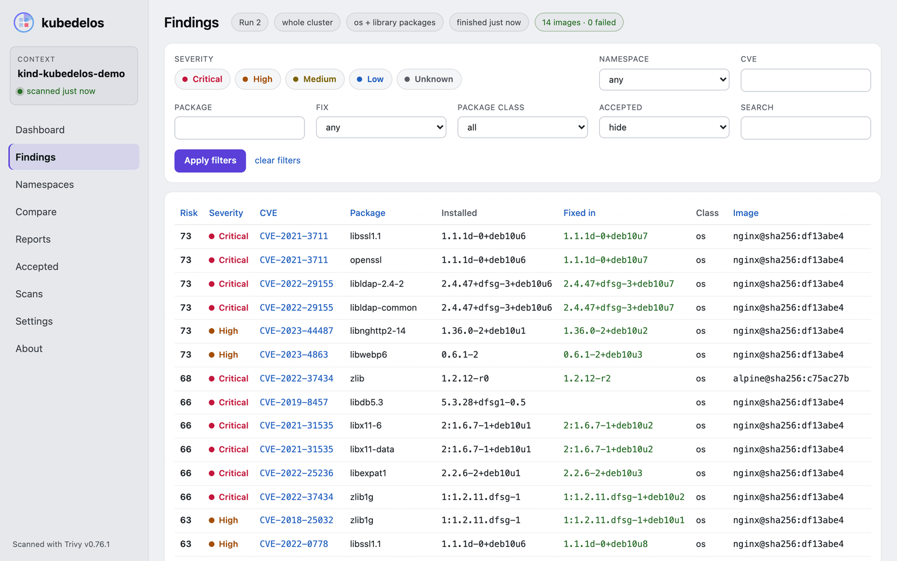

# The local web UI

`kubedelos ui` is the laptop mode: a web UI on loopback over your local scan database, from which you start
scans of any context in your kubeconfig. [Install](install.md) covers getting it; this page covers what each page
shows. The settings it reads are in [Configuration](configuration.md).

## Starting it

`kubedelos ui` serves a web UI on top of the scan data in your local SQLite database, and can start scans of any
context in your kubeconfig. It listens on loopback only (`127.0.0.1`, `::1` or `localhost`; other hosts are refused), prints a URL with a
token, and opens it in your browser:

```bash
kubedelos ui                          # http://127.0.0.1:9370/?token=...
kubedelos ui --port 9400 --no-browser
```

The token is swapped for a session cookie and stays valid until the server stops; a restart prints a new one. If the port
is in use, it exits 2 with `error: port N is in use; pass --port`. `--kubeconfig` chooses the kubeconfig, and `--context`
the context shown first (the current one by default). `KUBEDELOS_LOG_LEVEL=info` prints one access line (path only) per
request on stderr.

## Clusters and contexts

With more than one context, the sidebar's context card opens a list of them: every context in the kubeconfig, which is
read again on each page, plus any cluster that only appears in the scan history, each with when it was last scanned.
Picking one shows that cluster on the same page. The context travels in the URL (`?context=prod-eu`), so two tabs can
show two clusters and a link keeps its cluster. A cluster known only from the history is listed under the context of its
newest run, or under its key when that name is taken (a kubeconfig context of that name, or a context reused for
another cluster since), and can be viewed but not scanned.

Contexts that point at the same cluster (say `prod` and the `prod-admin` login that `az aks get-credentials --admin`
adds) are one cluster and share one history: the same runs, run numbers, accepted risks and last scan. A cluster is
known by its key: the kubeconfig cluster entry's API server URL (lower-cased, without a default port or trailing `/`),
its `tls-server-name` if set, and a fingerprint of its CA certificate, as in
`https://127.0.0.1:6443#sni=api.example.com#ca=1a2b3c4d5e6f`. So two clusters behind one URL, such as SSH tunnels to
`127.0.0.1:6443`, stay apart while their CAs differ. Rotating a cluster's CA (for example `az aks rotate-certs`)
changes its key, so its scans start a new history; the earlier runs stay viewable under the old key. Only the cluster
entry is read: no credentials, no login plugin.
A run made through another context than the one shown says so, as "via prod-admin" in the run line and in the Scans
history. Runs recorded before this are merged into their cluster the next time `kubedelos ui` starts, which prints one
line per merged context; the merged runs are renumbered in the order they ran.

A scan runs the context's kubeconfig login, as kubectl does. If that login needs a browser or a device code (`kubelogin`,
`aws sso`, `gcloud`), it happens in the terminal running `kubedelos ui`, and the scan fails with an error if nobody
completes it; log in with kubectl first.

## On a remote machine

To use it on a remote machine, forward the port over SSH and open the printed URL locally:

```bash
ssh -L 9370:127.0.0.1:9370 my-host
```

Keep the same port on both ends: the UI checks the `Host` header against the port it listens on, so `-L 9400:...` fails.

## Layout

Every page has a sidebar with the kube-context and a freshness dot that turns from green to amber once the shown run is
over 24 hours old, and a footer naming the Trivy that scanned it ("Scanned with Trivy v0.76.1", or "a custom Trivy" for
`KUBEDELOS_TRIVY_PATH` runs); below 760 px the sidebar becomes a top bar, which leaves the footer out. The page head names the
run in chips: its number (counted per cluster, so each cluster's first run is Run 1), scope, package types, age, image count and failures, and whether it is pinned or stale. The UI
follows the system light or dark theme.

## Pages

<picture>
  <source media="(prefers-color-scheme: dark)" srcset="images/findings-risk-dark.png">
  
</picture>

- **Dashboard (`/`)**: the latest whole-cluster run, with an incomplete marker when some namespaces could not be listed.
  KPI tiles show the change against the previous comparable run; the all findings tile carries a severity bar and a
  legend whose entries link to the findings. A Worst images panel ranks images by Critical and High, and a fix-first list
  is grouped by fix, or by image with `?by=image`. Failed images are counted by kind (timeout, not_found, auth...), one
  line each with what it means and a link to just those failures, plus a registry login hint and, where the run can be
  retried, a Retry button. A newer, narrower run is mentioned with a link to its findings.
- **Findings (`/findings`)**: filter by URL query (`severity`, `namespace`, `cve`, `package`, `has_fix`, `pkg`, `q`,
  `accepted`), sort, 100 per page. **download CSV** (`/findings.csv`, same parameters) saves every row of the view as
  filtered, streamed, with cells a spreadsheet would run as a formula prefixed with `'`. Accepted findings are hidden by default (`accepted=hide`; `only` and `all` show them
  with a badge), and the page says how many it left out. Each row has an **Accept…** link.
- **Namespaces (`/namespaces`)**: one row per namespace of the dashboard's run, worst first (Critical, then High),
  with owner, team, a count per severity, the total and the images. Every column sorts; `q` filters by namespace,
  owner or team, and `has` keeps namespaces with at least one finding of a severity. A namespace counts a finding when
  the finding's image runs there, as the findings page's namespace filter does, so each count links to exactly those
  findings.
- **Reports (`/reports`)**: the place to produce a report. Pick a run of the shown cluster (newest first) and open its
  print report, or pick a run and the findings filters (severity, namespace, fix, package class, accepted; Critical and
  High ticked) and download the CSV. The forms send what `/report` and `/findings.csv` take, so a CSV from here holds
  the same rows as the Findings page with those filters.
- **Report (`/report`)**: a print sheet of the dashboard's run (or `?run_id=`): cluster, run, scope, the counts per
  severity, the fix-first list (50 fixes, with how many accepted findings it leaves out) and the failed images. Print
  it, or save it as PDF, from the browser; the sidebar is left off the print. Linked from the Reports page, the
  dashboard's Fix first card and each run in the Scans history.
- **Compare (`/diff`)**: what changed between two runs of the shown cluster. By default it compares the dashboard's run
  with its previous comparable run; `from` and `to` (or the two pickers) choose any two. Images are matched by
  repository, so a tag bump reads as a changed image and a CVE that survives it stays open instead of showing as fixed
  and new. Tiles count new findings, fixed or gone, and images added, gone and changed; tables list the findings worst
  first, 100 at most with the real total. A difference in scope or package types, failed images or coverage gaps is
  named above the numbers. A finding open in both runs is only counted ("still open"), even if its severity or fix
  changed. The dashboard's change figures and each run in the Scans history link here.
- **Failed images (`/scans/<run>/failed`)**: every image of a run that failed to scan, named as `repo:tag` plus a short
  digest, with platform, error kind, namespaces and the cause in a few words ("tag 1.2 is not in the registry"). The full
  ref and the redacted error text are folded away under each row, and auth failures add registry login hints. A pill per
  kind, with its count, narrows the list (`?kind=timeout`). It is linked from the failed count in the Scans history, from the dashboard's Failed images panel and from the progress readout, which also
  lists the newest failures while the scan runs. An image that fails with a passing network error (an interrupted
  download, a reset connection, a 502/503/504 or 429 from the registry) is scanned once more after 2 seconds before it
  counts as failed, and is marked "retried" when the second attempt fails too. Timeouts, auth and not-found errors are
  not retried.
  - **Retry failed images:** the newest run of a cluster, once it finished partial, has a "Retry failed images" form
    here (and a "retry" link in the Scans history). It scans the run's failed images of the ticked kinds again (every
    kind but `not_found` at first, or just the kind the page is narrowed to), with the run's
    package types, a time limit per image (default 3× `KUBEDELOS_SCAN_TIMEOUT_S`, 60–3,600 s) and 2 parallel images
    by default, and puts the results into the same run: it becomes `ok` once nothing fails. The cluster is not read;
    the refs and workloads come from the run. It takes the one scan slot and shows its progress on the Scans page, and
    leaves a note on this page ("retried 17 failed images (timeout) at 12:40 UTC: 15 scanned, 2 still failing"). Large
    images that ran out of time usually pass with a longer limit and fewer parallel images; a `not_found` image is gone
    from the registry and fails again until its tag is pushed.
- **Accepted (`/accepted`)**: the accepted risk register. An acceptance names a CVE, a reason, an owner (your OS user
  by default) and an expiry (90 days by default, at most a year), and optionally a namespace, an image repository (any
  tag) and a package. It applies to its cluster, or to all clusters when you choose so. It takes the findings it covers
  off the fix-first list and the findings page until it expires or is revoked; KPIs, the severity bar, the namespaces
  page and every other count stay as they are. A finding stays on the work lists while its image also runs in a
  namespace the acceptance doesn't name. Each entry shows its state, days left and how many findings it covers in the
  dashboard's run, and is flagged when it covers nothing.
- **Scans (`/scans`)**: start a scan of the shown context; the button names it. The form takes namespaces, namespace exclusions, a namespace
  selector, a label selector, image exclusions, the number of images scanned in parallel (1–32) and package types, each
  prefilled from your settings and labelled with the saved value. What you change applies to that scan only.
  The UI runs one scan at a time, across all contexts; a second start while one runs is refused, and the other
  contexts' Scans pages name the cluster being scanned. A scan from another `kubedelos ui` doesn't block it. Progress updates every 2 seconds without a reload: the phase (Trivy DB, inventory, scanning,
  saving), N of M images, scanned, cached and failed counts, the last finished image, and an estimate once 5 images
  have been scanned. When the scan ends, the page reloads once to show the finished run. Cancel stops the scan once the
  images in flight finish. The run history lists every run, newest first, 25 per page, with status, scope, packages,
  images, failures and duration; only `ok` and `partial` runs link to their results, and a failed run that holds
  nothing says why under its status ("no namespace matched the scope; nothing was scanned"). Ctrl-C on `kubedelos ui` cancels
  a running scan, waits up to 10 seconds for the images in flight, then kills any Trivy process still running.
  Each finished run's duration links to its scan times.
- **Scan times (`/scans/<run>/times`)**: where a run's scanning time went. Each image's scan is timed, from start to
  result with downloads and a retry included, and stored with its result (schema migration 9). The page lists the 50
  slowest images with their result, and sums up: images timed, cached, the times added up, the longest, and the part
  the ten slowest took, which tells a few huge images from many ordinary ones. The failures page shows each failure's
  time too. Runs scanned before this have no times.
- **Settings (`/settings`)**: every setting this `kubedelos ui` started with, read-only, with its `KUBEDELOS_*`
  variable (or flag), its value and where the value came from (flag, environment or default), then the database file,
  the data and cache directories, the Trivy in use and the log level. No credentials are listed: kubedelos holds none,
  and registry logins stay in Docker's own config.
- **About (`/about`)**: how fresh the data is (when Trivy built the vulnerability and Java DBs in use, whether a
  newer one is out, and the shown context's newest scan), the kubedelos, Trivy and Python versions, the license, the
  project links including the security policy, and what kubedelos never does.

Add `?run_id=N` to pin a page to one run.

## Interrupted runs

Each scan run holds a lock file under the data directory for as long as it runs. A run left
`running` by a process that died (killed, crashed, or a laptop that went to sleep for good) has no live lock, so
`kubedelos ui` marks it `failed` at startup, printing a note such as `note: closed 2 interrupted runs`, and again before
each UI scan starts. A scan still running in another process holds its lock and is never touched.

## Old runs

At startup `kubedelos ui` also deletes runs older than `KUBEDELOS_RETENTION_DAYS` (180 days; `0` keeps every run),
printing a note such as `note: deleted 3 runs older than 180 days`. The newest run of each comparable scan (same
cluster, scope and package types) always stays, however old, so every cluster keeps its latest result. Risk
acceptances are never deleted.

## Related

- [How a scan works](how-scans-work.md): what a scan started from the Scans page does.
- [Risk score](risk-score.md): the order of the fix-first lists and the findings page's Risk column.
- [Ask your agent](mcp.md): the same data through `kubedelos mcp`.
- [All guides](README.md)
